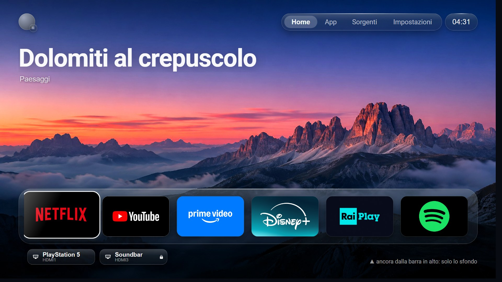
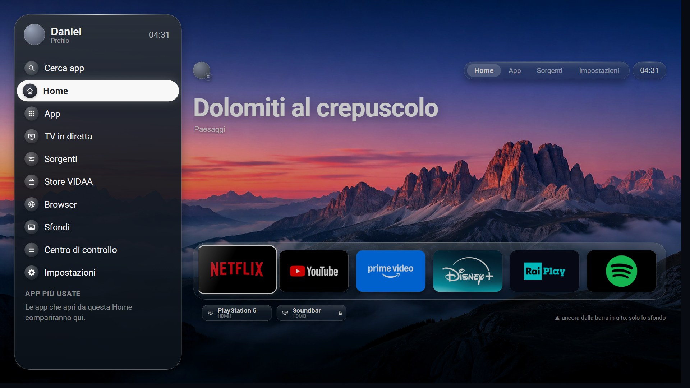
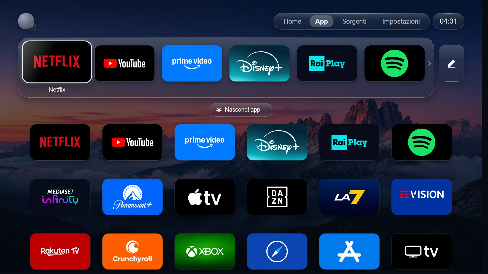
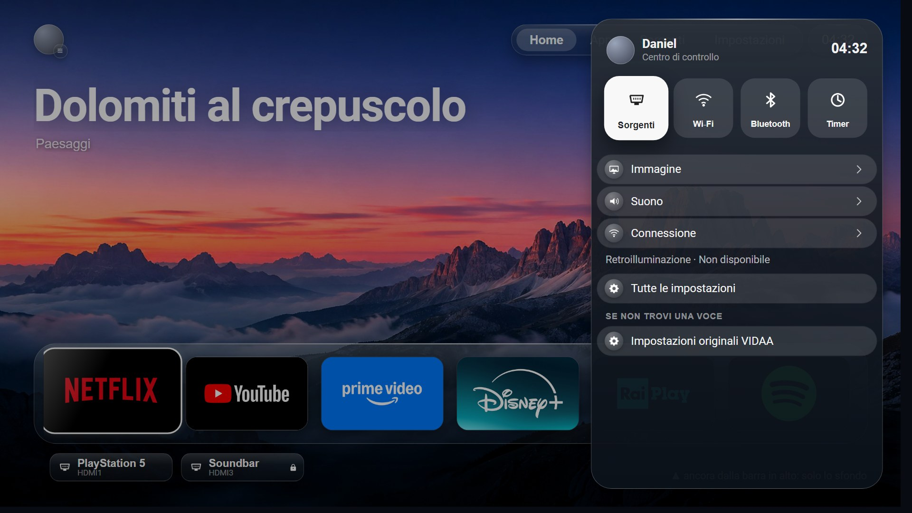
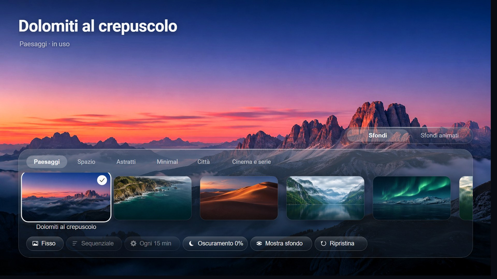
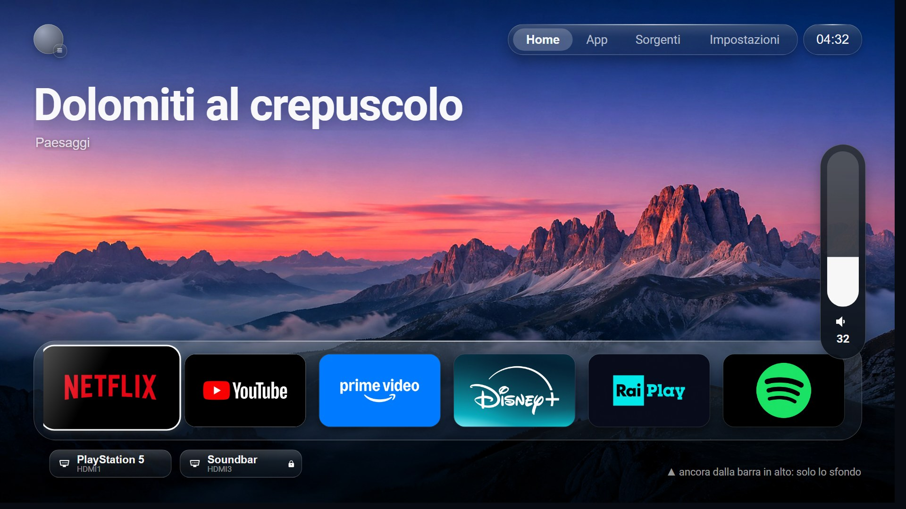
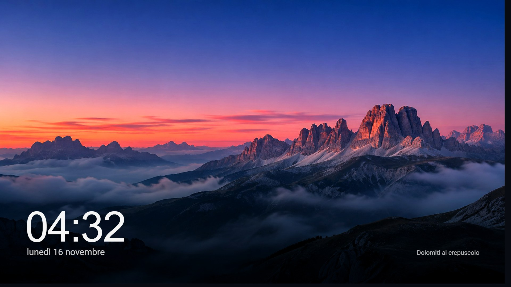
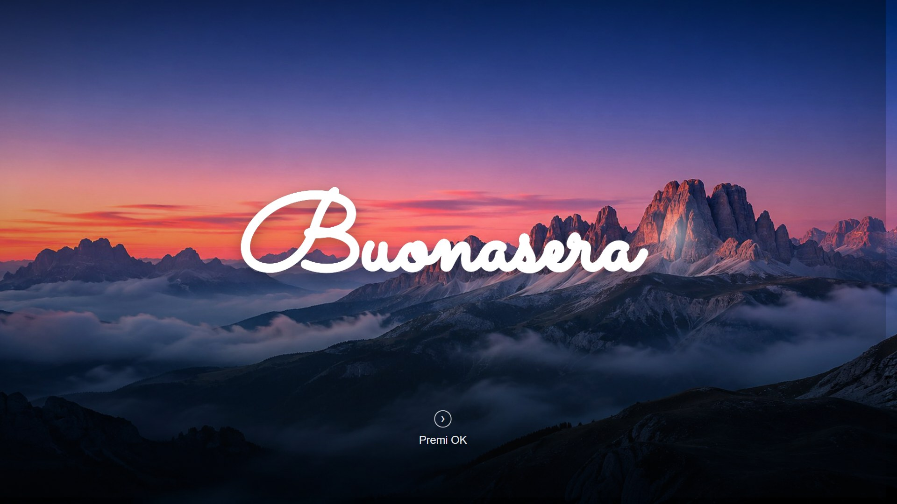

# Cloud TV — VIDAA (Hisense)

**A liquid-glass home screen for Hisense VIDAA TVs. The Apple-TV feel, installed over the air — no root flash, no new box.**

It replaces the TV's built-in launcher with a custom home: a glass dock, an app grid, a side menu, a Control Center, a volume capsule, slow launch and return animations, a greeting, a screensaver, and your own wallpapers and sounds — while every native setting still works.

[What you get](#what-you-get) · [How it works](#how-it-works) · [Install](#install) · [Settings](#settings) · [Sounds](#sounds) · [Going back](#going-back) · [Make it yours](#make-it-yours)



---

## What you get

- **A real home screen, not a grid of tiles.** Liquid-glass dock, large focus with a soft halo, app grid, and a slim side menu — all drawn by hand, animated on the GPU.
- **A Control Center that works inside apps too.** The three-line (menu) button opens our glass Control Center — Picture, Sound, Connection — in the home *and* on top of Netflix, YouTube and the rest, not the stock VIDAA panel.
- **A volume capsule.** A rounded glass volume indicator on the right, in the home and inside apps, that covers and replaces the stock VIDAA one.
- **Launch and return animations.** The icon floats to the centre over a blurred wallpaper, then hands off to the app; the reverse on the way back, with focus landing on the app you just closed. No loading bar, no "not responding".
- **A greeting.** A transparent glass "Buongiorno / Buon pomeriggio / Buonasera" that writes itself on wake.
- **Your wallpapers, your avatars, your sounds.** 33 processed wallpapers, custom app icons and avatars, and layered lo-fi UI sounds played through the TV's own speaker.
- **Every native setting, kept.** Picture, Sound, Accessibility, System, Channels, Wi-Fi/Bluetooth scanning and the volume read-out are wired to the real TV — the launcher never throws them away.
- **A way back, always.** Every install keeps a backup and a watchdog; one command restores the stock launcher.

| Home | Side menu | Apps | Control Center |
|---|---|---|---|
|  |  |  |  |
| **Wallpapers** | **Volume capsule** | **Screensaver** | **Greeting** |
|  |  |  |  |

---

## How it works

VIDAA's system UI (the "SystemUI") is a **Vue 2.7** app. Its launcher lives at the route `/0/Launcher`.

`home/native-home.js` is a single **ES5** bundle that, once loaded into the SystemUI, swaps that route's component for our own home, built with Vue 2.7 render functions. It adds:

- A **permanent layer** (`control.layer`) — a separate Vue root mounted on `<body>`, above everything, that survives the SystemUI destroying and rebuilding the launcher every time an app opens and closes. It draws the volume capsule and the in-app Control Center.
- A **persistent home** — the launcher route renders an empty shell; the real home is mounted once and only shown or hidden, instead of being rebuilt on every return from an app. This is what makes it feel fast.
- A **quick-menu swap** — when the TV navigates to its quick-settings page on top of an app, the route continues (so the TV keeps giving the SystemUI the screen and the keys) but the stock panel is replaced by an empty page with our Control Center on top.

Everything animates only `transform` and `opacity`, uses pre-blurred wallpapers (never a live blur), and targets a steady 60 fps on a cheap, several-year-old TV.

The current bundle is **`daniel-home-1.8.1`**.

---

## Install

> You need a PC on the same network as the TV, [Node.js](https://nodejs.org), and the TV's developer/WebDriver bridge reachable — the same setup the tools in `tools/` expect. This is an **unofficial** project; see the [disclaimer](#disclaimer).

### The easy way: an AI assistant

Open this repo in [Claude Code](https://claude.com/claude-code) (or any agent that reads `CLAUDE.md`) and tell it which TV you have and its IP. `CLAUDE.md` holds the hard rules and the exact install, restore and troubleshooting steps. It will connect, back up the stock launcher, install, and verify on the TV.

### The manual way

1. Copy `config.example.json` to `config.json` and fill in your TV's IP, the upload port, and your audio-helper token (see [Settings](#settings)).
2. Open the connection page (served on the upload port, default `8766`) **in the TV's browser, and keep it in front** — the tools talk to the TV through it.
3. From `tools/`, run the installer for your version (e.g. `node tv12.cjs installa` then `node tv12.cjs conferma`), then reload the interface.
4. For a full reload after a version change, unplug the TV for ~30 seconds — standby is not enough, the TV keeps the old home in memory.

The tools install with a backup and a 15-minute watchdog, so a failed install rolls itself back.

---

## Settings

Copy `config.example.json` → `config.json` (git-ignored) and set:

| Key | What it is | Default |
|---|---|---|
| `tvIp` | Your TV's address on the LAN | `192.168.1.100` |
| `uploadPort` | Port of the PC connection page the TV's browser opens | `8766` |
| `audioHelperPort` | Port of the native sound helper on the TV | `8772` |
| `audioToken` | Token the sound helper expects (`X-Vidaa-Token`) | — |

Nothing real is committed: the repo ships placeholders only.

---

## Sounds

UI sounds play through a tiny **native audio helper** that runs on the TV and listens on `127.0.0.1:8772`. It is started at boot by a small hook that waits for the TV to be ready and restarts the helper if it stops. The launcher sends it the pre-decoded sounds; if the helper is down, the UI stays silent rather than erroring.

Source for the helper and its build are in `tools/tv-1.2/`. Sound files (for listening on a PC) are in `sounds/`.

---

## Going back

- `node tools/tv-1.2/tv12.cjs ripristina` restores the previously installed launcher, **or**
- put back the saved copy of the previous version and reinstall.

The stock launcher is never deleted — it is backed up on every install.

---

## Make it yours

- **Wallpapers** live in `assets/wallpapers/` (processed) and `assets/wallpapers-originali/` (originals). Pre-blurred versions are generated for the launch/return animations.
- **App icons** and **avatars** are in `assets/app-icons/` and `assets/avatars/`.
- **Another TV / model?** The VIDAA specifics (the launcher route, the stock volume element `div.volume-bar`, the quick-settings route) are documented in `CLAUDE.md` under "Adapting it to another TV".

---

## Project layout

```
home/        native-home.js — the launcher bundle (ES5, Vue 2.7 render functions) + transizione-home.js
assets/      wallpapers, app icons, avatars
sounds/      UI sounds (.wav) + the native audio helper source (in tools/tv-1.2)
tools/       install / probe / screenshot / benchmark scripts (Node) per version
previews/    screenshots used in this README and the changelog
docs/it/     Italian delivery notes and per-version changelog
```

---

## Versions

The full, per-version history (in Italian) is in [`docs/it/`](docs/it/) — `CONSEGNA.md` is the running delivery log, `AGGIORNAMENTO-*.md` are the per-release notes. Current: **1.8.1** (persistent home, in-app Control Center, volume capsule over the stock one, pre-blurred launch animations).

---

## Credits

- Greeting font: **Sacramento** (Google Fonts, SIL Open Font License), embedded in the bundle.
- Built with **Vue 2.7** render functions inside the VIDAA SystemUI.

---

## License

[MIT](LICENSE).

---

## Disclaimer

This is an **unofficial, personal** project. It is **not affiliated with, endorsed by, or supported by Hisense or VIDAA**. It modifies your TV's system UI; you run it **at your own risk**. Always keep the backup the tools create. Wallpapers, icons and avatars in `assets/` are provided for personal use.
